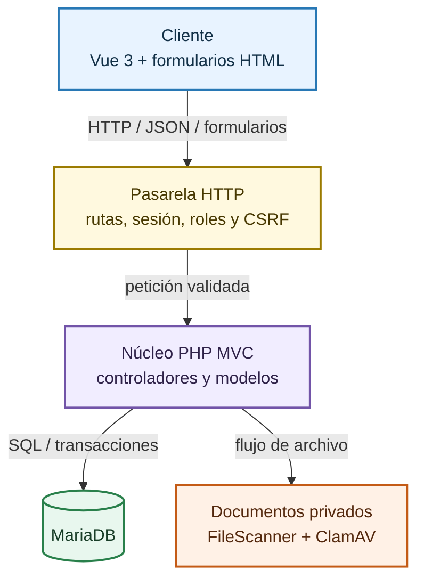
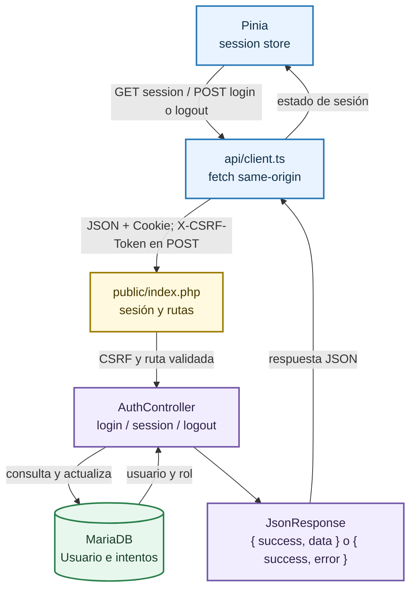
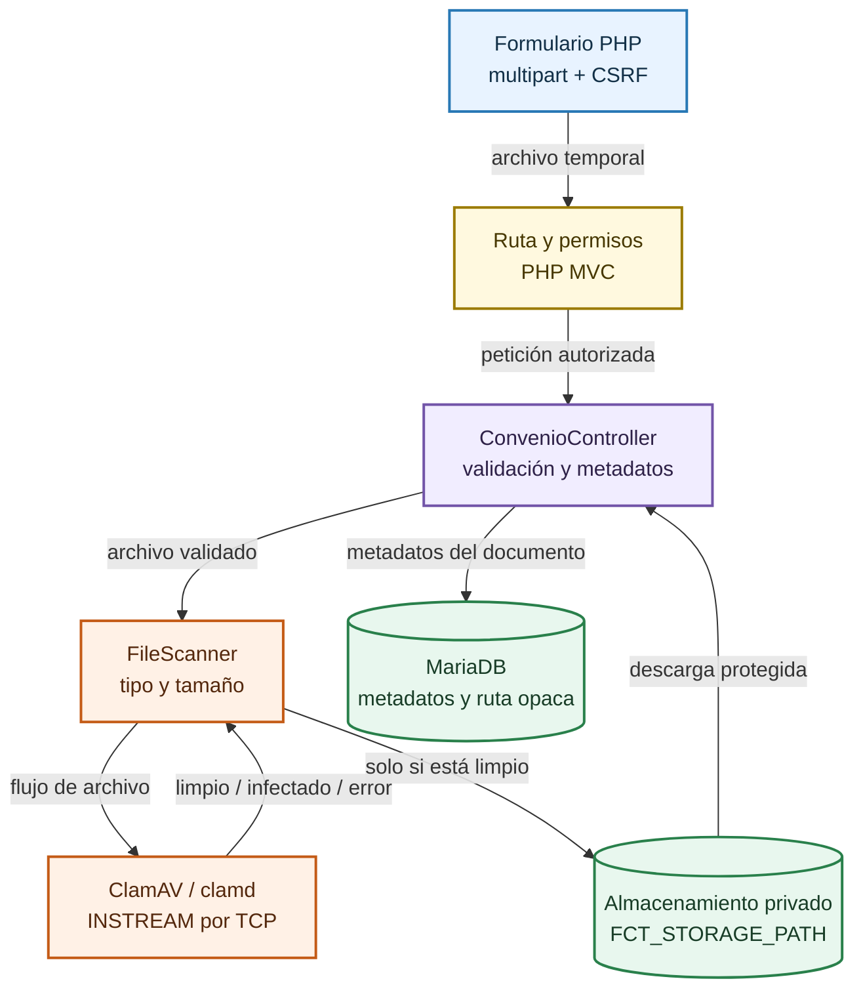
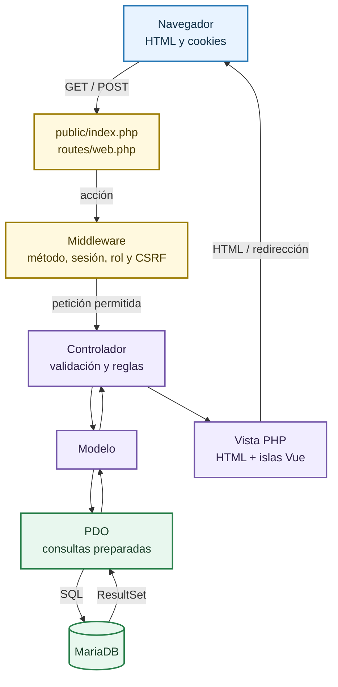

# Diagrama completo de arquitectura

Vista de referencia de los límites del sistema y sus recorridos principales. Cada subsistema conserva su propio diagrama para que los detalles no reduzcan la legibilidad del mapa general.

## Límites del sistema

## Autenticación y sesión

## Ciclo de vida de un convenio PDF

## Petición MVC tradicional

<a href="/flujo-de-datos">Volver al documento de arquitectura y ciclo de vida</a>

