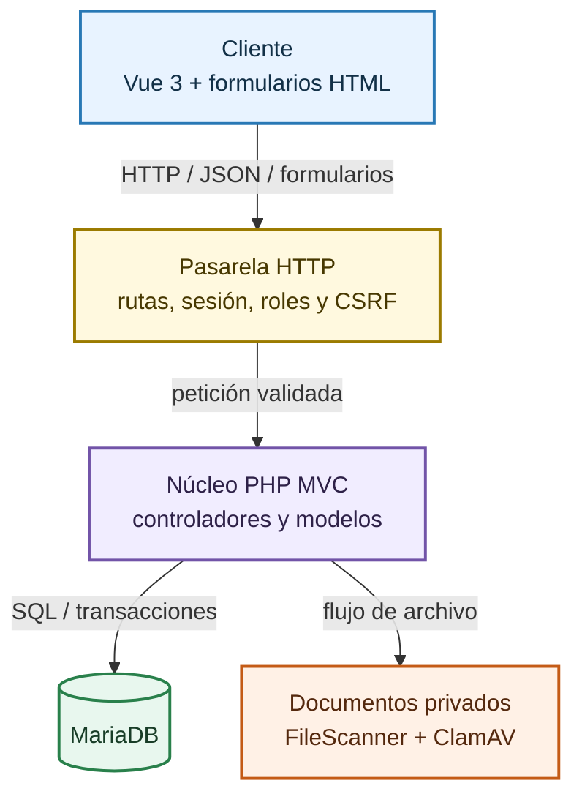
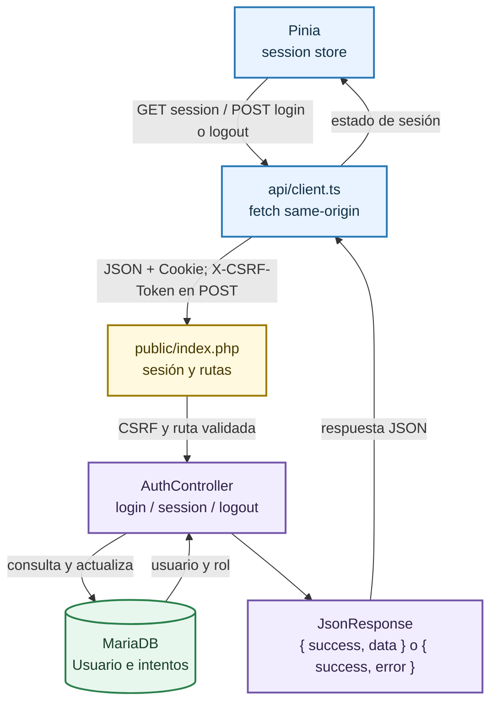
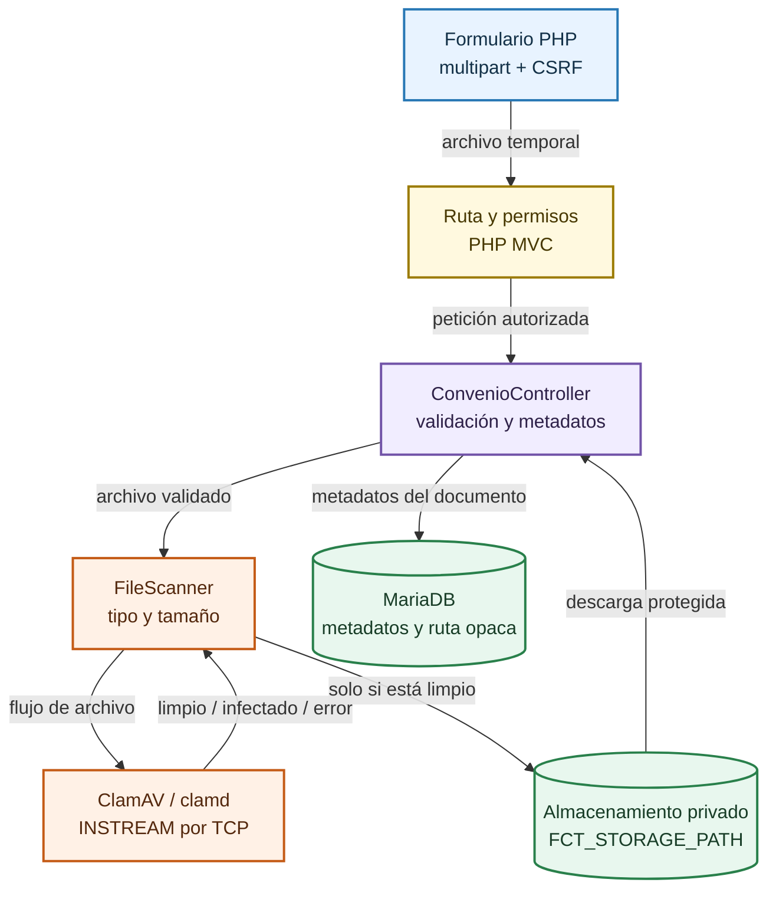
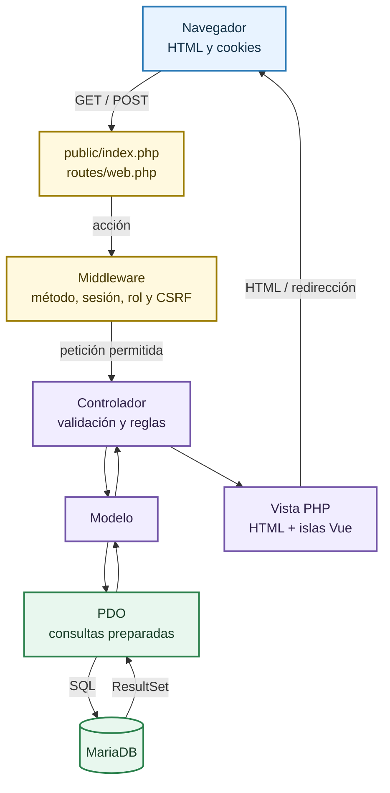

# Arquitectura: flujo de datos y ciclo de vida

Este documento describe el recorrido actual de una petición por la aplicación híbrida PHP MVC y las islas progresivas Vue. No todas las acciones son JSON: las rutas progresivas negocian JSON cuando se montan sus islas y conservan formularios PHP y validación del servidor como fallback.

## Arquitectura de un vistazo

El mapa completo está dividido en recorridos independientes para que el texto siga siendo legible en pantallas pequeñas. Abre el [diagrama completo a ancho ampliado](/diagrama-completo) o continúa con cada subsistema.

## Recorridos principales

### Autenticación y sesión

El login PHP sigue funcionando como fallback. Cuando Vue está disponible, Pinia usa el mismo origen y envía CSRF para las mutaciones JSON.

### Ciclo de vida de un convenio PDF

El archivo se analiza antes de llegar al almacenamiento privado. Si ClamAV no está disponible o detecta una amenaza, la carga no se acepta.

### Petición MVC tradicional

Las páginas y formularios siguen procesándose en PHP. Vue mejora algunas interacciones, pero no sustituye el enrutamiento ni las protecciones del servidor.

Cada bloque representa un recorrido independiente; las reglas compartidas de sesión, autorización y CSRF se aplican en la pasarela PHP antes de ejecutar las acciones protegidas.

### Convenciones de seguridad y respuesta

- `public/index.php` inicia una sesión PHP con `HttpOnly`, `SameSite=Lax` y `Secure` cuando la petición usa HTTPS; además establece CSP y cabeceras de protección.
- Las rutas con roles consultan usuario y estado activo en MariaDB antes de despachar. Las rutas POST verifican CSRF: campo `_csrf` en formularios o cabecera `X-CSRF-Token` en JSON.
- El transporte JSON está implementado en `JsonResponse`. Login, sesión, logout, disponibilidad, asignaciones, calificaciones y revisiones progresivas lo usan con `{ success, data }` o `{ success, error }`; las vistas tradicionales conservan sus formularios y redirecciones.
- La isla `StudentProfile` envía el perfil como JSON con `X-CSRF-Token`; `perfil-alumno` sigue protegido por `AuthMiddleware` para el rol Alumno y por el middleware CSRF. Sin JavaScript, el formulario POST tradicional continúa disponible.
- La isla `AvailabilitySchedule` mejora la tabla semanal, copia el horario del lunes a martes-viernes sin enlazar los campos y guarda franjas exactas mediante `POST disponibilidad` JSON con `X-CSRF-Token`. El turno se conserva solo por compatibilidad histórica.
- La isla `ReviewOfferDecision` envía la decisión de una oferta por `POST revisar-oferta` JSON con `X-CSRF-Token`. Solo Administrador puede resolverla; la aprobación conserva la comprobación transaccional del convenio y de la existencia de franjas aplicables.
- La isla de borrado mejora la interfaz; su mutación sigue siendo un formulario PHP protegido por CSRF y validado en el servidor.
- El PDF de convenio se valida por tipo, tamaño y carga real, se analiza con ClamAV y se mueve a `FCT_STORAGE_PATH`, fuera del document root. Si el scanner no está disponible, la carga falla cerrada. MariaDB guarda metadatos y ruta opaca; una descarga pasa por control de acceso antes de transmitir el flujo.

## Reglas funcionales de disponibilidad y matching

El matching compara la especialidad del expediente con la de la oferta (por ejemplo, DAW con DAW y DAM con DAM), exige disponibilidad que cubra el periodo completo de la oferta, una oferta aprobada con horarios semanales publicados y plazas libres. El alumno tampoco puede mantener otra asignación activa. La interfaz puede ayudar a localizar candidatos, pero `Asignacion::crear` vuelve a validar estas reglas dentro de una transacción antes de guardar.

La disponibilidad del alumno se define por periodo y tiene dos modos horarios:

- **Franjas por día:** se indican días y horas concretas; todas las franjas de la oferta que caen dentro del periodo deben quedar cubiertas en el mismo día.
- **Indiferente:** acepta cualquier horario ofertado y desactiva la edición de franjas. Sólo se omite la comparación horaria; siguen siendo obligatorios el ciclo, el periodo completo, la aprobación, los horarios de la oferta y las plazas.

La isla `AvailabilitySchedule` permite aplicar una franja general a varios días y después editar cada día. El guardado requiere enviar el formulario; Vue muestra estados reactivos de envío, éxito o error y envía `X-CSRF-Token`. No es autoguardado. Si no se monta Vue, el formulario HTML sigue enviándose a PHP con `_csrf`. Un horario histórico de oferta que no tenga franjas semanales exactas queda fuera del matching hasta que la empresa publique de nuevo la oferta con horario.

Las notas de prácticas admiten valores de **0 a 10 con hasta dos decimales**, validados en el servidor; Administrador y Coordinador pueden registrarlas y cada alumno sólo consulta sus propias notas. El tema claro/oscuro se aplica desde la isla `ThemeToggle`: sigue inicialmente la preferencia del sistema, y el cambio manual persiste en `localStorage` del navegador.

Para roles y alcance de lectura, consulta [Roles y permisos](/roles_y_permisos). En particular, Observador no puede mutar datos, ve el alumnado anonimizado y no accede a documentos privados.

### Disponibilidad del antivirus en desarrollo

`FileScanner` analiza el archivo por TCP INSTREAM cuando `FCT_CLAMAV_ENABLED=true` (valor de reserva requerido en producción). En un entorno local sin antivirus, `FCT_CLAMAV_ENABLED=false` sólo permite omitir el scanner si `APP_ENV` es `development`, `test` o `testing`; configura ambos valores explícitamente y el sistema escribe una advertencia en el log. No es una recuperación automática ante fallos de ClamAV. Compose usa `APP_ENV=production` y mantiene el escaneo habilitado si no se definen variables. Cuando el escaneo está habilitado, ClamAV no disponible, firmas antiguas, timeout o respuesta `FOUND` rechazan la carga. Para probar el fallo, fija `FCT_CLAMAV_ENABLED=true` y detén temporalmente el servicio en una instalación desechable. No expongas el puerto del scanner ni uses archivos de prueba infectados fuera de un entorno aislado. Consulta [seguridad y antivirus](/seguridad_y_antivirus).

## Catálogo de rutas HTTP

Las acciones son valores de `index.php?action=...`. Los métodos y roles se obtienen de `routes/web.php`; el `AuthMiddleware` aplica a las rutas que declaran roles y el CSRF a todas las peticiones POST.

| Grupo | Acciones | Métodos | Roles |
|---|---|---|---|
| Inicio y autenticación | `inicio` | GET | Público |
|  | `login` | GET, POST | Público |
|  | `session` | GET | Público; la respuesta informa `user: null` si no hay sesión válida y 403 para Empresa sin aprobar |
|  | `logout` | POST | Administrador, Coordinador, Observador, Empresa, Alumno |
| Recuperación | `recuperar`, `restablecer` | GET, POST | Público |
|  | `api-solicitar-reset-password`, `api-confirmar-reset-password` | POST | Público con CSRF |
|  | `recuperaciones`, `admin-solicitudes-password` | GET | Administrador |
|  | `aprobar-reset-password`, `rechazar-reset-password`, `api-aprobar-reset-password`, `api-rechazar-reset-password` | POST | Administrador; CSRF |
| Registro y catálogo autenticado | `registro-alumno`, `registro-empresa` | GET, POST | Público |
|  | `api-registro-empresa` | POST | Público; sesión MVC y CSRF para `/api/public/empresas/solicitud` (alias `/registro`) |
|  | `empresas-centro` | GET | Administrador, Coordinador |
|  | `solicitudes-empresa`, `admin-convenios`, `formulario-aprobar-empresa` | GET | Administrador |
|  | `aprobar-empresa`, `api-aprobar-empresa` | POST | Administrador; CSRF |
|  | `solicitud-pendiente` | GET | Público con estado flash de sesión; estado MVC para solicitudes no aprobadas |
|  | `ofertas` | GET | Administrador, Coordinador, Observador, Empresa |
| Alumno | `portal-alumno`, `mis-asignaciones`, `mis-calificaciones` | GET | Alumno |
|  | `perfil-alumno`, `disponibilidad` | GET, POST | Alumno |
|  | `empresa-asignada` | GET | Alumno; datos de interés de su práctica activa |
| Empresa | `publicar-oferta`, `sedes`, `convenios` | GET, POST | Empresa |
|  | `descargar-convenio` | GET | Administrador, Coordinador, Empresa |
| Gestión de ofertas | `revisar-ofertas` | GET | Administrador, Coordinador |
|  | `revisar-oferta` | POST | Administrador |
| Asignaciones | `asignaciones` | GET | Administrador, Coordinador, Observador |
|  | `emparejar` | GET | Administrador, Coordinador |
|  | `asignar-alumno`, `cerrar-practica` | POST | Administrador, Coordinador |
| Convenios | `revisar-convenios` | GET | Administrador, Coordinador |
|  | `resolver-convenio` | POST | Administrador |
|  | `auditar-convenios` | GET | Observador; metadatos anonimizados/sin documentos |
| Calificaciones | `calificaciones` | GET | Administrador, Coordinador, Observador |
|  | `guardar-calificacion` | POST | Administrador, Coordinador |
| Consultas y administración | `consultas` | GET | Administrador, Coordinador, Observador |
|  | `usuarios` | GET, POST | Administrador |
|  | `estado-usuario`, `eliminar-usuario` | POST | Administrador |
| Integraciones | `api-tokens` | GET, POST | Administrador; emite (el valor en claro se muestra una vez) y revoca tokens de la API |
|  | `pruebas-integracion` | GET, POST | Administrador; pruebas sintéticas de recepción y envío de webhooks |
|  | `webhook-inbox`, `webhooks-recibidos` | GET | Administrador; ambas acciones ejecutan `WebhookInboxController::listarRecibidos` (últimos 50 eventos de `webhook_inbox`) |
|  | `webhooks-enviados` | GET | Administrador; últimos 50 eventos de `webhook_outbox` |
|  | `webhooks-empresa` | GET | Administrador; actividad de webhooks filtrada por `empresa_id` |

`routes/web.php` declara 48 acciones estáticas, todas recogidas arriba. Además, `preview-disponibilidad` y `preview-publicar-oferta` (públicas, GET, vistas de desarrollo) se registran sólo cuando `APP_ENV` es `development` o `local`; no forman parte del catálogo de producción.

La definición completa del rol de auditoría y sus límites está en [Roles y permisos](/roles_y_permisos).

## Tabla del ciclo de vida de los datos

| Disparador | Componente / store | Ruta HTTP | Controlador / servicio | BD / servicio | Respuesta |
|---|---|---|---|---|---|
| Abrir una página o seguir un enlace | Navegador; plantillas PHP | `GET index.php?action=...` | `public/index.php` → middleware → controlador | PDO/MariaDB según pantalla | HTML de `View` + layout; redirección cuando corresponde |
| Cargar el inicio sin sesión | Navegador; Vue no sustituye el contenido público | `GET inicio` | Entrada → `home/index` | Ninguna obligatoria | Landing HTML PHP |
| Cargar el login | `AuthLoginEnhancement` se monta junto al formulario PHP | `GET login` | `AuthController::login` | Genera/reutiliza token CSRF de sesión | HTML; isla Vue mejora el envío si Vite está habilitado |
| Consultar sesión | `RoleDashboard` / Pinia `session` | `GET session`, `Accept: application/json` | `AuthController::session` | Consulta `usuarios` por ID de sesión y verifica `activo` | `{ success: true, data: { user, csrfToken } }`; `user` es `null` si no está autenticado |
| Iniciar sesión | `AuthLoginEnhancement` → `api/client.ts` → Pinia | `POST login`, JSON `{ email, password }`, `X-CSRF-Token` | `AuthController::login` | `IntentoLogin` + `Usuario`; verificación de hash; `session_regenerate_id` | JSON de éxito con usuario/rol y nuevo token; errores JSON con status HTTP; sin JSON sigue formulario/redirección |
| Cerrar sesión | Pinia `session` / formulario PHP | `POST logout`; JSON incluye `X-CSRF-Token` o form usa `_csrf` | `AuthController::logout` | Destruye sesión y expira cookie | JSON `{ user: null }` o redirección HTML a login |
| Editar perfil de alumno | `StudentProfile` + Pinia `student-profile` | `POST perfil-alumno`, JSON con `X-CSRF-Token`; fallback urlencoded con `_csrf` | `AuthMiddleware` (Alumno) + `CsrfMiddleware` → `AlumnoController::editarPerfil` | Validación del servidor y `Alumno::actualizarPerfil`; transacción sobre usuario, alumno, contacto y tutor | JSON `{ success: true, data: { message } }` / `{ success: false, error }`; fallback HTML con redirección |
| Guardar disponibilidad semanal | `AvailabilitySchedule` dentro del formulario PHP | `POST disponibilidad`, JSON `{ fecha_inicio, fecha_fin, turno, es_indiferente, horarios }` con `X-CSRF-Token`; fallback urlencoded con `_csrf` | `AuthMiddleware` (Alumno) + `CsrfMiddleware` → `DisponibilidadController::gestionar` | Valida periodo y franjas exactas; `turno` se conserva como dato legado y no decide compatibilidad. `Disponibilidad::reemplazar` actualiza las tablas de disponibilidad en una transacción | JSON `{ success: true, data: { message } }` / `{ success: false, error }`; fallback HTML con redirección |
| Publicar oferta | Formulario PHP con jornada normal o partida y franjas para cada día | `POST publicar-oferta` con `jornada=normal|partida`, `horarios[dia][hora_inicio/hora_fin]` y, en jornada partida, `hora_inicio_2/hora_fin_2` | `OfertaController` | `Oferta` guarda la jornada y los intervalos semanales en `empresa_especialidades_plazas` y `empresa_oferta_horarios_semanales` dentro de la transacción de publicación y registra auditoría | Redirección; listado renderizado por PHP |
| Aprobar o rechazar oferta | Formulario con isla `ReviewOfferDecision` | `POST revisar-oferta`, JSON `{ oferta_id, decision, motivo }` con `X-CSRF-Token`; fallback urlencoded con `_csrf` | `AuthMiddleware` (Administrador) + `CsrfMiddleware` → `OfertaController::resolverRevision` | Transacción, horario exacto, convenio aprobado que cubre ciclo/periodo, `Oferta::resolver` y auditoría | JSON `{ success: true, data: { message, decision } }` / `{ success: false, error }`; fallback HTML con redirección |
| Aprobar o rechazar convenio | Formulario PHP con isla `ReviewAgreementDecision` y store Pinia `agreement-review` | `POST resolver-convenio`, JSON `{ convenio_id, decision, motivo }` con `X-CSRF-Token`; fallback urlencoded con `_csrf` | `AuthMiddleware` (Administrador) + `CsrfMiddleware` → `ConvenioController::resolver` | `Convenio::resolver` actualiza solo convenios pendientes; transacción y auditoría en `Auditoria` | JSON `{ success: true, data: { message, decision } }` / `{ success: false, error }`; fallback HTML con redirección |
| Emparejar candidato y asignar práctica | Formulario PHP con isla `AssignStudent` + Pinia `assignment` | `POST asignar-alumno`, JSON `{ oferta_id, alumno_id, tutor_empresa }` con `X-CSRF-Token`; fallback urlencoded con `_csrf` | `AuthMiddleware` (Administrador/Coordinador) + `CsrfMiddleware` → `AsignacionController::asignar` | `Asignacion::crear` valida estado de oferta, bloquea cupo/alumno, revalida compatibilidad, inserta y audita en una transacción | JSON `{ success: true, data: { message } }` (201) / `{ success: false, error }`; fallback HTML con redirección |
| Cerrar práctica y registrar nota | Formularios PHP; isla `GradeForm` aplica máscara y envío JSON | `POST cerrar-practica` / `POST guardar-calificacion` | `AsignacionController` / `CalificacionController` | `asignaciones_fct`, `calificaciones_fct` y auditoría; el servidor impone 0–10 y hasta dos decimales | JSON discriminado o fallback HTML con redirección |
| Consultar empresa asignada | Isla `AssignedCompany` del portal | `GET empresa-asignada` | `AuthMiddleware` (Alumno) → `AsignacionController::empresaAsignada` | Consulta por la identidad autenticada y devuelve detalles de interés sin datos de contacto privados | JSON `{ success: true, data: { nombre_empresa, categoria, nombre_especialidad, fecha_inicio, fecha_fin } }` o error 404 |
| Subir convenio PDF | Formulario multipart PHP | `POST convenios` con `_csrf` y archivo | `ConvenioController::guardarConvenio` | Valida datos/MIME/tamaño; `FileScanner` → ClamAV; mueve el archivo limpio a almacenamiento privado; `Convenio` guarda metadatos | Redirección de éxito o vista con error; si no se puede analizar, no se guarda |
| Descargar convenio | Enlace con ID | `GET descargar-convenio&id=...` | `AuthMiddleware` + `ConvenioController::descargar` | Verifica propiedad/rol, registra denegación si aplica, lee almacenamiento privado | Flujo PDF de descarga; no expone la ruta física |
| Solicitar/restablecer contraseña | Formulario PHP con islas `OlvidePassword` y `RestablecerPassword` | `POST /api/auth/solicitar-reset-password`, `POST /api/auth/confirmar-reset-password`; fallback MVC `recuperar` / `restablecer` | `RecuperacionController` → `SolicitudResetPassword` | Registra solicitud pendiente sin enumerar cuentas; aprobación de Administrador crea hash del token, guarda vencimiento 24h y envía correo; confirmación actualiza `usuarios` y consume el token | Respuesta genérica de solicitud, errores estructurados y formulario HTML fallback |
| Cambiar estado o borrar usuario | Tabla y `UserDeleteDialog`; confirmación Vue, envío PHP | `POST estado-usuario` / `POST eliminar-usuario` con `_csrf` | `UsuarioAdminController` → `Usuario` | Control de rol, integridad, auditoría y eliminación/actualización | Redirección a gestión de cuentas con resultado |

### Contratos y persistencia

- El contrato discriminado de frontend es `ApiResponse<T>` en `frontend/src/types/api.ts`: éxito `{ success: true, data: T }`; error `{ success: false, error: string }`.
- El guardado del perfil usa el tipo `ProfileUpdatePayload` en `frontend/src/types/profile.ts` y la tienda Pinia `frontend/src/stores/studentProfile.ts`.
- La disponibilidad usa `AvailabilityUpdatePayload` en `frontend/src/types/availability.ts`. Su estado es local a la isla Vue y la petición pasa por `frontend/src/api/client.ts`; no requiere una tienda Pinia compartida. El botón de autocompletado copia lunes a martes-viernes sin enlazar sus campos.
- Las ofertas nuevas persisten la jornada (`normal` o `partida`) y sus franjas exactas por día. Una jornada partida almacena dos intervalos diarios; los registros históricos reciben la jornada normal y conservan su intervalo único. Las ofertas sin horarios no participan en matching ni se pueden aprobar de nuevo hasta que se publiquen con franjas exactas.
- La disponibilidad del alumnado guarda `es_indiferente` junto a las franjas semanales exactas. Si es verdadero, el matching acepta cualquier horario de oferta, manteniendo los controles de ciclo, periodo, estado de oferta, franjas publicadas y plazas; en caso contrario exige que cada intervalo de la oferta esté completamente cubierto en el mismo día. Las antiguas etiquetas de turno no deciden compatibilidad.
- La revisión usa `OfferReviewPayload` y `OfferReviewResult` en `frontend/src/types/offerReview.ts`; `ReviewOfferDecision` presenta carga, confirmación y errores del servidor sin estado compartido entre ofertas.
- `frontend/src/api/client.ts` fuerza `Accept: application/json`, establece `Content-Type` cuando hay cuerpo y usa `credentials: same-origin`. Para acciones protegidas añade la cabecera CSRF explícita.
- Los modelos usan PDO y consultas preparadas. El esquema base vive en `database/sistema_fct.sql`, las transformaciones secuenciales en `database/migrations/` y los datos de ejemplo en `database/seeds/`.
- `FrontendAssets` agrega `@vite/client` y el entrypoint en desarrollo; fuera de desarrollo lee `public/build/.vite/manifest.json`. La falta de Vue conserva los formularios/fallback PHP donde están definidos.

## Guía de extensibilidad

1. **Añade primero la ruta PHP** en `routes/web.php`: método HTTP, roles mínimos, controlador y acción. Si es POST, conserva CSRF; las rutas JSON también pasan por el mismo middleware.
2. **Traza el flujo del servidor** desde la acción del controlador hasta el modelo y las tablas implicadas. Añade al diagrama un nodo de ruta en el bloque de rutas y otro de controlador/modelo en el subgrafo PHP; conecta ambos con la etiqueta del formato real (`FormData`, DTO/array, SQL ResultSet o flujo de archivo).
3. **Mantén la respuesta coherente con la superficie**: para HTML, renderiza con `View` o redirige; para JSON, usa `JsonResponse` y documenta el envelope, códigos HTTP, cabeceras y payload TypeScript. No marques como JSON rutas que actualmente responden HTML.
4. **Si añades una isla Vue**, crea el componente en `frontend/src/islands/`; `main.ts` lo descubre mediante `import.meta.glob`. Añade el marcador `data-vue-island` y props `data-prop-*` a la vista PHP; si la acción cambia datos, conserva un formulario/endpoint de servidor con autorización y CSRF.
5. **Si requiere estado compartido**, extiende una tienda existente o crea una en `frontend/src/stores/`. Mantén Pinia para estado entre islas relacionadas; no añadas Vue Router mientras las páginas sigan navegándose por las acciones MVC.
6. **Para archivos**, documenta el trayecto temporal → validación → análisis antivirus → almacenamiento privado → metadatos. No sirvas documentos privados desde `public/` ni omitas el análisis requerido.
7. **Actualiza esta tabla y el catálogo de rutas** en el mismo cambio que añade la funcionalidad. Usa nodos de dominio aislados y reusa las pasarelas base; evita dibujar una cadena nueva desde el navegador para cada endpoint.
8. **Valida el cambio** con `npm run typecheck`, `npm run build`, `php -l` para PHP modificado y las pruebas correspondientes. Para cambios de seguridad de archivos, ejecuta además `tests/file_security.php`; prueba integraciones contra una base desechable `fct_test_*`.

## Fuentes de verdad

- Enrutamiento y roles: `routes/web.php`.
- Ciclo HTTP, sesión, CSRF, CSP, captura de errores y layout: `public/index.php`.
- Sesión/autenticación: `app/Controllers/AuthController.php`, `app/Middleware/AuthMiddleware.php`, `app/Middleware/CsrfMiddleware.php`.
- Montaje y assets Vue: `frontend/src/main.ts`, `app/Core/FrontendAssets.php`, `vite.config.ts`.
- Contrato JSON y sesión Vue: `app/Core/JsonResponse.php`, `frontend/src/api/client.ts`, `frontend/src/stores/session.ts`.
- Carga segura: `app/Controllers/ConvenioController.php`, `app/Core/FileScanner.php`, `config/storage.php`, servicio `clamav` de `docker-compose.yml`.
- Persistencia: `config/database.php`, `app/Models/`, `database/sistema_fct.sql`, `database/migrations/`.
