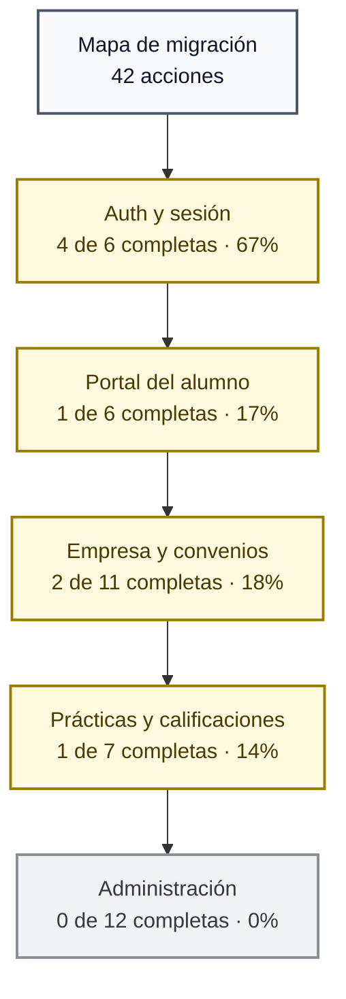
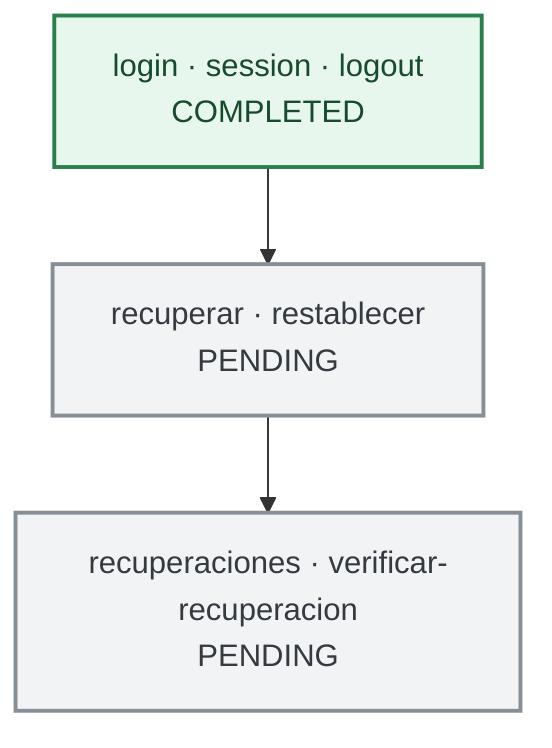
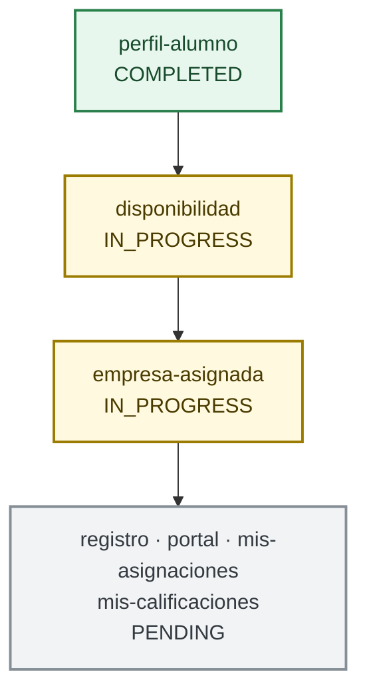
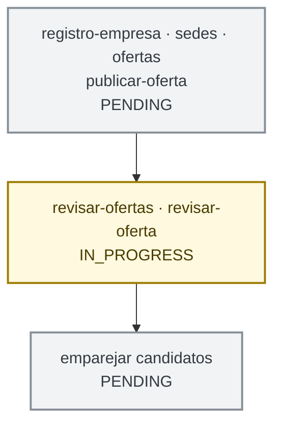
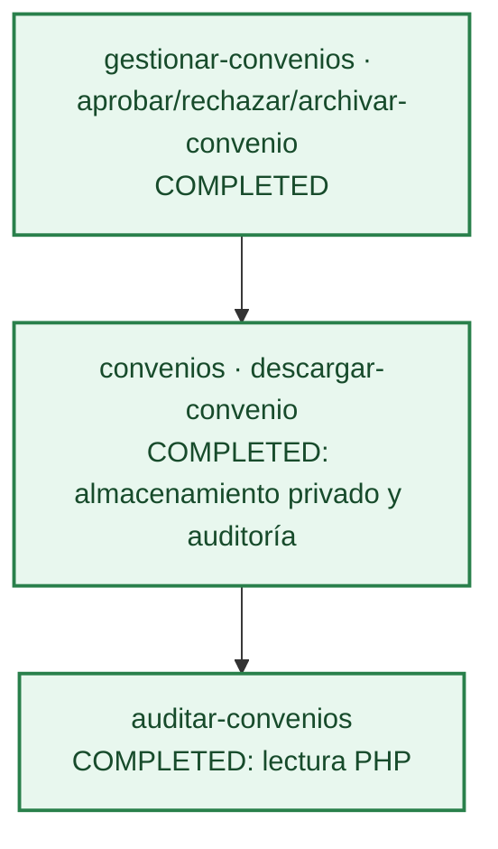
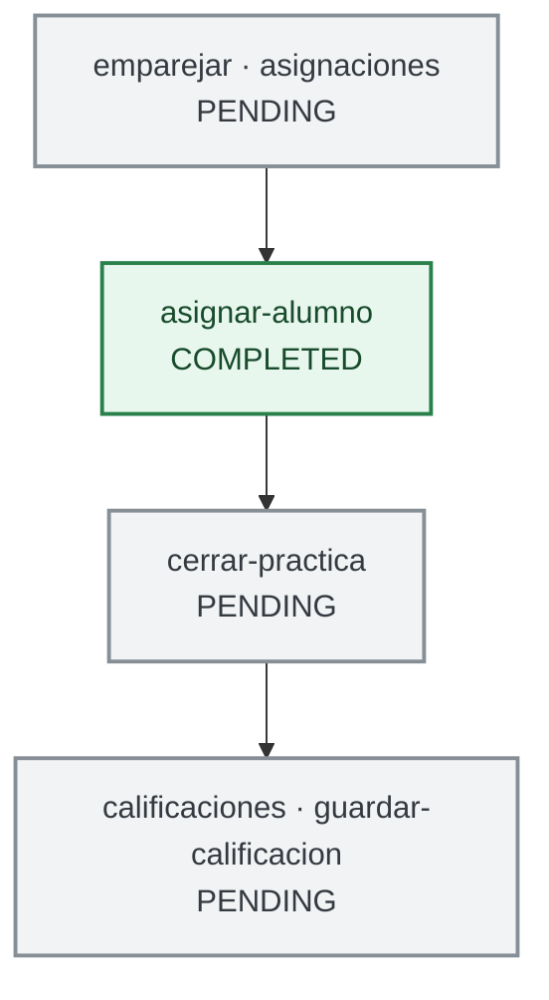
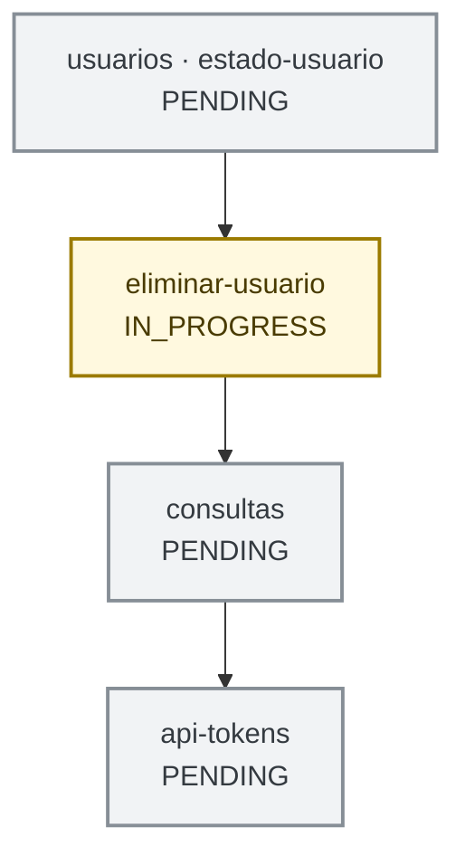

# Hoja de ruta de migración

Esta hoja cruza las acciones declaradas en `routes/web.php` con sus controladores, vistas y las islas descubiertas por `frontend/src/main.ts`. Los estados describen el avance de la mejora progresiva, no autorizan a retirar el controlador PHP ni su fallback.

## Criterios de estado

- **COMPLETED**: una operación interactiva cuenta con isla Vue 3, petición JSON con sobre `JsonResponse` y estado Pinia. El POST PHP tradicional continúa disponible como fallback.
- **IN_PROGRESS**: existe una isla o negociación JSON, pero falta completar al menos una de esas capas o la resiliencia acordada.
- **PENDING**: la acción continúa en el flujo PHP síncrono o no tiene aún una mejora interactiva.
- Las páginas HTML de lectura y las descargas siguen siendo responsabilidad del MVC PHP; se clasifican por el estado de su módulo y no se exponen como JSON solo para satisfacer el objetivo de migración.

## Resumen visual

El inventario cubre **42 acciones de ruta**: **8 completadas (19,0%)**, **5 en progreso (11,9%)** y **29 pendientes (69,0%)**. El porcentaje mide filas de acciones del catálogo, no esfuerzo ni cobertura funcional; las cadenas de abajo muestran orden de lectura y dependencias documentadas, no nuevas rutas. Las vistas previas `preview-disponibilidad` y `preview-publicar-oferta` sólo se registran con `APP_ENV` `development` o `local` y quedan fuera del inventario.

Los conectores anteriores organizan visualmente los dominios; para dependencias reales de implementación, consulta la columna **Dependencias / restricciones** de la tabla.

## Micro-roadmaps por dominio

Cada acordeón contiene un diagrama pequeño de arriba hacia abajo. Los diagramas usan el estado de la operación y mantienen los archivos y formularios PHP como fallback o superficie autoritativa.

Autenticación y recuperación de cuenta

Portal del alumno

Empresa y ofertas

Convenios y documentos

La carga y descarga se mantienen en PHP: ClamAV debe fallar cerrado y los documentos deben permanecer en almacenamiento privado, fuera de `public/`.

Asignaciones y calificaciones

Administración

## Inventario de acciones HTTP

`AuthMiddleware` aplica los roles declarados por ruta; `CsrfMiddleware` valida las mutaciones POST antes de ejecutar el controlador. `HTML + redirect` indica el flujo síncrono PHP actual. Cuando no se cita un DTO JSON, aún no existe contrato de isla para esa acción.

| Módulo | Acción HTTP | Estado | Arquitectura actual | Arquitectura objetivo | Dependencias / restricciones | Prioridad |
|---|---|---|---|---|---|---|
| Auth y sesión | `GET inicio` | COMPLETED | PHP HTML + isla `RoleDashboard`; sesión consultada por JSON/Pinia | Mantener layout MVC y mejorar panel por rol progresivamente | Mantener navegación por `routes/web.php`, sin router SPA | P3 |
| Auth y sesión | `GET, POST login` | COMPLETED | Formulario PHP fallback + `AuthLoginEnhancement`, `AuthController` JSON y store `session` | Conservar fallback; endurecer estados del formulario si se amplía | CSRF en POST, regeneración de sesión | P3 |
| Auth y sesión | `GET session` | COMPLETED | `AuthController::session` devuelve sobre JSON consumido por Pinia | Mantener contrato `ApiResponse` | Cookie de sesión y validación de usuario activo | P3 |
| Auth y sesión | `POST logout` | COMPLETED | `RoleDashboard`/Pinia usa `AuthController` JSON; fallback formulario | Mantener invalidación de sesión en servidor | CSRF y expiración de cookie | P3 |
| Recuperación | `GET, POST recuperar` | PENDING | Formulario PHP síncrono | Isla progresiva con respuesta JSON y estado de envío | Respuesta genérica para no filtrar existencia de cuentas; límites de intentos | P2 |
| Recuperación | `GET, POST restablecer` | PENDING | Formulario PHP síncrono | Isla progresiva con validación y JSON | Token hash, expiración, uso único y política de contraseña | P2 |
| Administración | `GET recuperaciones` | PENDING | Listado PHP protegido | Mantener lectura PHP; mejorar acciones sólo cuando haya necesidad | Administrador/Coordinador | P3 |
| Administración | `POST verificar-recuperacion` | PENDING | Formulario PHP síncrono | Isla JSON con estado y errores accesibles | Autorización, CSRF y auditoría/limpieza de token | P2 |
| Administración | `GET alumnos-centro`, `GET, POST alta-alumno`, `POST actualizar-alumno-centro` | COMPLETED | Sección PHP independiente para altas; la consulta permite filtrar y editar expedientes existentes | Mantener navegación por enlaces MVC y mejora progresiva | Roles y CSRF, documento NIF/NIE/DNI con letra de control o pasaporte de 6–15 caracteres, ciclo existente, transacción y auditoría | P2 |
| Administración | `GET, POST alta-personal`, `GET usuarios` | COMPLETED | Alta separada de la consulta y gestión de cuentas | Mantener los flujos PHP síncronos | Rol Administrador; integridad referencial y activación segura por correo | P2 |
| Portal del alumno | `GET portal-alumno` | PENDING | Vista PHP de expediente | Mantener render inicial PHP; añadir isla sólo para widgets interactivos | Rol Alumno y datos del propio expediente | P3 |
| Portal del alumno | `GET, POST perfil-alumno` | COMPLETED | Isla `StudentProfile`, DTO JSON, store `student-profile`, fallback PHP | Mantener contrato y ampliar sólo ante nuevos campos | Validación de expediente y transacción del modelo | P3 |
| Empresa y ofertas | `GET, POST registro-empresa` | PENDING | Registro PHP síncrono | Isla con contrato JSON y estado Pinia manteniendo fallback | Creación atómica Usuario/Empresa y unicidad de correo/NIF (Persona Jurídica) con control válido | P2 |
| Empresa y ofertas | `GET ofertas` | PENDING | Catálogo HTML renderizado por PHP | Mantener render PHP; añadir filtros Vue sólo si se necesita interacción rica | Público; no cargar ofertas privadas | P3 |
| Empresa y ofertas | `GET, POST publicar-oferta` | PENDING | Formulario PHP; comprobación de convenio en servidor | Isla con validación JSON manteniendo fallback | Requiere convenio aprobado y fechas cubiertas; plazas/ciclo válidos | P1 |
| Empresa y ofertas | `GET, POST sedes` | PENDING | Gestión PHP síncrona | Isla JSON/Pinia manteniendo fallback | Empresa autenticada; pertenencia de la sede | P2 |
| Empresa y ofertas | `GET revisar-ofertas` | IN_PROGRESS | Listado PHP con isla de revisión por decisión | Completar carga/estado del listado sin desplazar el render MVC | Roles Administrador/Coordinador | P2 |
| Empresa y ofertas | `POST revisar-oferta` | IN_PROGRESS | Isla Vue + JSON, sin store Pinia dedicado | Tipar payload y estado en Pinia; conservar fallback | Decisión puede exigir convenio vigente; transacción/auditoría | P2 |
| Portal del alumno | `GET, POST disponibilidad` | IN_PROGRESS | Isla `AvailabilitySchedule` y JSON, estado de isla no centralizado en Pinia | Store Pinia, reset al desmontar y conservar HTML fallback | Fechas, franjas y turno deben seguir validados por servidor | P2 |
| Asignaciones | `GET asignaciones` | PENDING | Listado HTML PHP | Mantener lectura PHP; Vue sólo para mutaciones interactivas | Roles Administrador/Coordinador/Observador | P2 |
| Asignaciones | `GET emparejar` | PENDING | Matching PHP calcula capacidad y candidatos compatibles | Mantener matching PHP; mejoras Vue desacopladas del cálculo autoritativo | Requiere oferta aprobada, disponibilidad/ciclo/turno y plazas | P1 |
| Portal del alumno | `GET mis-asignaciones` | PENDING | Vista de sólo lectura PHP | Mantener render PHP; enriquecer progresivamente si aporta valor | Filtrado por usuario de sesión | P3 |
| Portal del alumno | `GET empresa-asignada` | IN_PROGRESS | Isla `AssignedCompany` (montada en `portal.php` si hay una asignación `Asignada`) consume `AsignacionController::empresaAsignada` por JSON con `requestApi`; sin store Pinia | Centralizar estado y tipos en un store Pinia; mantener el listado PHP de asignaciones como render inicial | Sólo rol Alumno; identidad de sesión sin ID de cliente; 404 si no hay práctica activa; sin datos de contacto privados | P3 |
| Calificaciones | `GET calificaciones` | PENDING | Listado PHP | Mantener render PHP; mejora interactiva aislada | Roles de lectura definidos en la ruta | P2 |
| Calificaciones | `GET mis-calificaciones` | PENDING | Listado PHP de sólo lectura | Mantener render PHP | Filtrado estricto por sesión | P3 |
| Calificaciones | `POST guardar-calificacion` | PENDING | Formulario PHP y redirección con error | Isla JSON/Pinia y fallback | Sólo prácticas cerradas; nota 0–10; CSRF y auditoría | P1 |
| Asignaciones | `POST asignar-alumno` | COMPLETED | Formulario PHP fallback + isla `AssignStudent`, JSON y store `assignment` | Mantener la asignación autoritativa en PDO; Vue mejora envío/errores | Oferta aprobada, bloqueo de cupo/alumno, compatibilidad y auditoría en transacción | P0 — completado |
| Asignaciones | `POST cerrar-practica` | PENDING | Formulario PHP síncrono | Isla JSON/Pinia manteniendo formulario fallback | Sólo asignaciones activas; debe preceder a la calificación | P1 — siguiente |
| Convenios | `GET, POST convenios` | PENDING | Formulario multipart PHP | Mantener flujo multipart PHP; no convertir el pipeline a JSON sin necesidad | Validación MIME/extensión/tamaño, ClamAV fail-closed y almacenamiento privado | P3 — seguridad |
| Convenios | `GET gestionar-convenios` (aliases `revisar-convenios`, `archivo-convenios`) | COMPLETED | Vista PHP unificada con pestañas, filtros parametrizados y paginación | Mantener formularios/fallback HTML y permisos | Coordinador consulta pendientes; Administrador consulta todos los estados | P3 |
| Convenios | `POST aprobar-convenio`, `POST rechazar-convenio`, `POST archivar-convenio` (alias `resolver-convenio`) | COMPLETED | Formularios HTML con CSRF | Mantener transacciones y auditoría de estado anterior/nuevo | Administrador; sólo transiciones de estado permitidas | P3 |
| Convenios | `GET descargar-convenio` | COMPLETED | Descarga PHP protegida, flujo binario no JSON | Mantener descarga en servidor; no exponer documentos a Vue/public | Sólo Administrador; almacenamiento privado y auditoría | P3 — no convertir a JSON |
| Convenios | `GET auditar-convenios` | COMPLETED | Vista PHP `convenios/observador` con `Convenio::listarParaObservador`; sin isla | Mantener lectura PHP | Sólo rol Observador; metadatos anonimizados, sin enlaces ni descargas de PDF | P3 |
| Administración | `POST estado-usuario` | PENDING | Formulario PHP síncrono | Isla JSON/Pinia y fallback | Rol Administrador; no permitir desactivar cuenta protegida | P2 |
| Administración | `POST eliminar-usuario` | IN_PROGRESS | Confirmación `UserDeleteDialog` en Vue; mutación todavía HTML/PHP | Añadir contrato JSON y store sólo si se preservan confirmación y fallback | Rol Administrador, restricciones referenciales y auditoría | P2 |
| Administración | `GET consultas` | PENDING | Búsqueda/reportes renderizados por PHP | Mantener lectura PHP; aplicar mejora Vue sólo para búsqueda interactiva | Autorización por roles; limitar campos y resultados | P3 |
| Administración | `GET, POST api-tokens` | PENDING | Formularios PHP (`ApiTokenAdminController::gestionar`, vista `admin/api_tokens`); sin isla | Mantener lectura PHP; las mutaciones siguen en formulario PHP con CSRF | Sólo Administrador; se guarda `token_hash` y el valor en claro se muestra una vez al crearlo; la revocación fija `revoked_at` | P3 |

> Nota: `logout` está declarado una sola vez en `routes/web.php`; aparece en el dominio de sesión y no representa dos acciones distintas. La ruta `descargar-convenio` y la carga de `convenios` se mantienen deliberadamente como PHP por su manejo seguro de archivos.

## Orden sugerido

1. **`cerrar-practica`**: siguiente mutación pendiente del ciclo de vida; desbloquea la calificación de una práctica finalizada.
2. **`guardar-calificacion`**: completar el flujo académico posterior al cierre, con validación del dominio y auditoría.
3. **`publicar-oferta`**: operación de entrada a la cadena; requiere mantener el control de convenio aprobado.
4. **`revisar-oferta`**: completar Pinia/estados y resiliencia ya iniciados.
5. **Disponibilidad y recuperación**: completar estado de frontend y reducir recargas, preservando invariantes del dominio y antifuerza bruta.

## Sincronización y verificación

- Al añadir una ruta, registrar método/rol, controlador, dependencias, contrato de respuesta y estado en esta matriz.
- Cambiar el nodo de Mermaid al mismo tiempo que el estado de su módulo; reflejar dependencias reales, no sólo orden de implementación.
- Mantener JSON bajo `JsonResponse`, envío de `X-CSRF-Token`, autorización de `routes/web.php` y formularios HTML con `_csrf`.
- Para cambios de archivos, mantener ClamAV fail-closed y `FCT_STORAGE_PATH`; no incorporar PDFs al flujo de islas.
- Ejecutar `npm run typecheck`, `npm run build`, `npm run docs:build` y un lint con PHP 8.2 sobre cada controlador PHP modificado (`docker compose run --rm --no-deps -T app php -l <ruta>`).
